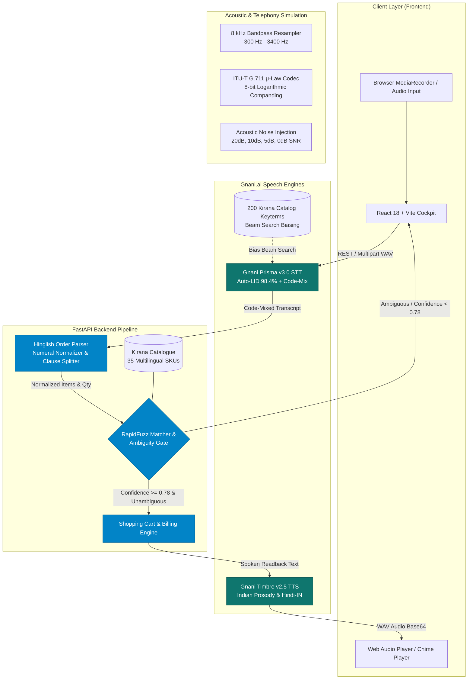
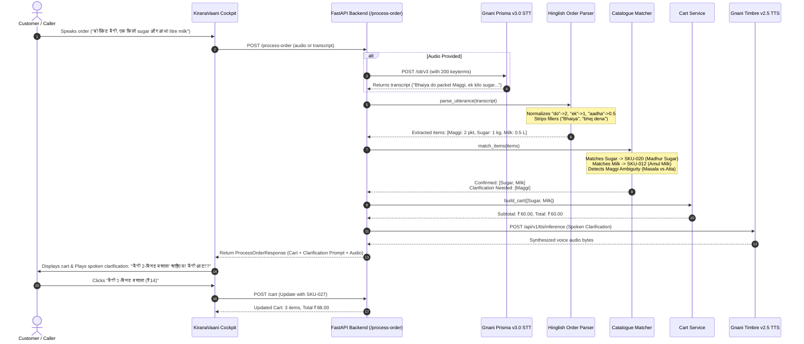

# KiranaVaani — Technical Architecture Specification

This document details the software architecture, speech processing pipeline, conversational state machine, and data flow of **KiranaVaani**.

---

## 1. High-Level System Architecture

---

## 2. End-to-End Execution Sequence

---

## 3. Core Subsystems

### 3.1. Telephony Channel & Acoustic Noise Injection
- **Resampling**: Standardizes input to 8 kHz sampling rate with a 4th-order Butterworth bandpass filter (300 Hz – 3400 Hz).
- **ITU-T G.711 $\mu$-law**: Compresses input with 8-bit non-linear quantization ($\mu = 255$).
- **Noise Injection**: Injects calibrated additive noise at +30 dB, +20 dB, +10 dB, +5 dB, and 0 dB SNR based on RMS power ratio:
  $$\alpha = \sqrt{\frac{P_{\text{speech}}}{P_{\text{noise}} \cdot 10^{\text{SNR}/10}}}$$

### 3.2. Hinglish Order Parser
- **Boundary-Safe Numeral Replacement**: Replaces multi-word fractional phrases (*"सवा दो"*, *"पौने दो"*, *"साढ़े तीन"*, *"पाव भर"*) before matching single-word numerals (*"ढाई"*, *"डेढ़"*, *"आधा"*).
- **Regex Boundary Lookarounds**: Uses `(?<![\w\u0900-\u097F])` and `(?![\w\u0900-\u097F])` to ensure Hindi characters are not broken midway through a ligature.
- **Unit Normalization**: Standardizes `kilo`, `kg`, `किलो` to `kg`, and converts `500 gram` to `0.5 kg` when the catalog unit is `kg`.

### 3.3. Catalogue Matcher & Ambiguity Gate
- **Family Ambiguity Resolvers**: Detects generic base nouns (*"chawal"*, *"dal"*, *"tel"*, *"maggi"*) that have multiple distinct SKU variants in store.
- **Score Delta Check**: If the similarity difference between candidate 1 and candidate 2 is $< 0.12$ and score is $< 0.92$, the matcher refuses to guess and emits a `ClarificationQuestion`.
- **Confidence Threshold**: Any candidate scoring below $0.78$ triggers a confirmation query rather than silent addition to the cart.

### 3.4. Gnani AI Timbre Speech Generation
- Formats synthesized spoken readbacks in colloquial Hindi/Hinglish.
- Generates natural phonetic pauses and summary cadence (*"Aapke order me 2 packet Maggi... kul 106 rupaye"*).
- Includes graceful zero-dependency fallback WAV synthesis when deployed without live cloud keys.
